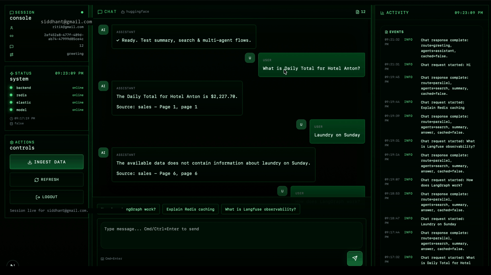

<div align="center">

# Multi-Agent AI System

**A production-ready multi-agent AI chat and document intelligence system**



</div>

## Overview

A robust AI chat architecture featuring multiple coordinated agents working together:
- **Supervisor Agent**: Intelligently routes queries and determines execution flow.
- **Search Agent**: Indexes and queries Elasticsearch for grounded document retrieval.
- **Summary Agent**: Condenses complex documents and long-form responses.

Upload documents (PDF, CSV), query context-grounded data, and trace agent decision paths with live telemetry.

## Tech Stack

**Backend**
- **FastAPI**: Asynchronous REST API service
- **LangChain / LangGraph**: Agent orchestration and workflow execution
- **Redis**: Fast session caching & conversation memory
- **Elasticsearch**: Dense and sparse vector document indexing
- **HuggingFace & LLMs**: Text embeddings and generative models

**Frontend**
- **Next.js 15**: Modern App Router & React 19 architecture
- **TypeScript**: Full type safety
- **Tailwind CSS & Lucide Icons**: Cyberpunk / terminal console aesthetic

## Getting Started

### Prerequisites
- Docker or Podman
- Python 3.10+
- Node.js 18+

### 1. Environment Configuration
Copy the sample environment files and configure your credentials:
```bash
cp backend/.env.example backend/.env
cp frontend/.env.example frontend/.env.local
```

### 2. Infrastructure Setup
Start Redis and Elasticsearch:
```bash
podman-compose up -d
# or: docker compose up -d
```

### 3. Backend Setup
```bash
cd backend
pip install -r requirements.txt
uvicorn app.main:app --reload --port 8000
```

### 4. Frontend Setup
```bash
cd frontend
npm install
npm run dev
```

Open `http://localhost:3000` in your browser.

---

## Author

- **Siddhant Gudwani** ([@SiddGud](https://github.com/SiddGud))

⭐ Star this repository if you find it helpful!
